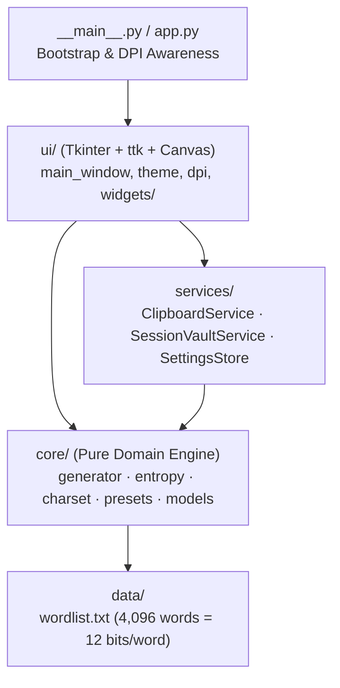

# Architecture & 2022 → 2026 Transformation

## 1. Legacy Prototype Audit (2022)

The original 2022 coursework prototype (`Project FA22 - Password Generator With GUI.ipynb`) consisted of a single Jupyter Notebook code cell (~72 lines) combining RNG logic and Tkinter widgets into global scope. Key security and engineering defects identified:

| Category | 2022 Prototype Flaw | 2026 Production Resolution |
| :--- | :--- | :--- |
| **Randomness** | Used `random.randint()` and `random.shuffle()` (Mersenne Twister PRNG, predictable from observed outputs). | Uses `secrets.choice()`, `secrets.token_urlsafe()`, `secrets.token_hex()`, and `secrets.SystemRandom()` backed by the OS CSPRNG (`BCryptGenRandom` / `os.urandom`). |
| **Alphabet & Bias** | Hardcoded 12 fixed slots with overlapping `randint` bounds (e.g., `48..58` includes `:`, `59..65` overlaps `A`, `33..48` overlaps `0`, `107..123` overlaps `{`) and Latin-Extended codepoints (`191..290`). | Clean, configurable ASCII character classes, ambiguous-glyph filtering (`0O1lI`), custom symbols, custom exclusions, uniform sampling, and Fisher-Yates CSPRNG shuffle. |
| **Configurability** | Static 12-character password only. | 4 dynamic modes (**Password** 4–128 chars, **Diceware Passphrase** 4–12 words over 4,096 A–Z words, **API Token** 128–512 bits, **Hardened PIN** 4–16 digits) + 6 presets + 5x batch generation. |
| **Clipboard Hygiene** | Plaintext `clipboard_append` persisted indefinitely; `print(TV1.get())` leaked state to stdout. | `ClipboardService` enforces a configurable auto-clear countdown (`15s`–`120s`) and checks clipboard ownership before wiping so unrelated user copies are never overwritten. |
| **Secret Persistence** | None / ad-hoc. | **Zero disk persistence for secrets.** `SessionVaultService` holds recent secrets strictly in RAM (masked by default) and wipes them on exit; `SettingsStore` persists only non-secret UI preferences. |
| **GUI & Scaling** | Fixed `606x300` geometry with `.place(x, y)` coordinates, garish colors, and overwritten `copy_button` variable. | Per-Monitor v2 DPI awareness (`dpi.py`), synchronized `tk scaling`, responsive `grid` workstation layout, Obsidian Dark & Studio Light themes, custom HiDPI `Canvas` widgets, and keyboard shortcuts. |
| **Engineering Tooling** | Monolithic `.ipynb` with no packaging, types, lints, or tests. | Modular `src/` layout on Python `3.14.7`, managed by Astral `uv`, enforced by `ruff` (incl. Bandit `S` rules), statically type-checked with `pyrefly`, and verified by `pytest`. |

---

## 2. Layered System Architecture (2026)

### Dependency Direction Rules

1. **`core/`** has **zero UI or filesystem dependencies**. Every generator, character pool validator, and entropy auditor operates on immutable frozen dataclasses and can be tested or reused independently.
2. **`services/`** manages side effects cleanly behind interfaces (`ClipboardBackend` `Protocol` for deterministic timer/clipboard testing, RAM-only `SessionVaultService`, and safe non-secret JSON `SettingsStore`).
3. **`ui/`** binds `tkinter`/`ttk` state to `core/` and `services/`, handles Windows Per-Monitor v2 DPI scaling (`dpi.py`), renders custom HiDPI canvas controls (`ToggleSwitch`, `StrengthMeterCanvas`), and provides real-time auditing even on user-typed secrets.

---

## 3. Threat Model & Cryptographic Notes

- **CSPRNG Guarantee:** All secret generation relies exclusively on Python's `secrets` module (no `random` module imports anywhere in the codebase, enforced by Ruff rule `S311`).
- **Uniformity vs. Constraints:** Random passwords guarantee at least 1 character from each enabled class, sample remaining positions uniformly across the active alphabet, and apply a cryptographic Fisher-Yates shuffle. When `no_adjacent_repeats` is active, uniform shuffles are retried up to 32 times before applying a class-preserving repair pass.
- **Brute-Force Estimator:** Reports median (50%) crack time across three 2026 threat baselines:
  - Online throttled (`100` guesses/sec)
  - Offline slow KDF — Argon2id GPU cluster (`1,000,000` guesses/sec)
  - Offline fast hash — SHA-256 ASIC/GPU array (`100,000,000,000` guesses/sec)
- **Zero-Disk Secret Policy:** Generated secrets are never logged, never saved to preferences, and never written to temporary files.
